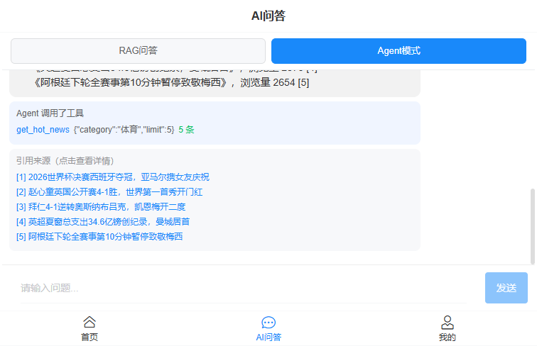

# 新闻资讯系统 · RAG / Agent 增强版

基于 FastAPI 的新闻资讯服务，在原有「新闻 + 用户 + 收藏 + 历史 + 数据导入导出」基础上，
补齐了 **RAG 知识检索问答** 与 **Agent 工具调用** 两条 AI 链路。

一个后端同时提供两种问答模式：

- **RAG 问答**：固定管道「检索 → 拼装 → 生成 → 引用溯源」，可控、可评测。
- **Agent 问答**：把控制流交给模型，由它自己决定调用哪个工具、调用几次、何时结束。

**Agent 模式实拍**（真实运行截图，非模拟）：



图中：模型自主选择 `get_hot_news` 工具并填入参数 `{"category":"体育","limit":5}`，
返回 5 条结果后生成带 `[1]~[5]` 引用的答案。工具轨迹与引用列表由后端事件流推送，
前端实时渲染。

---

## 快速开始

### 1. 环境

- Python 3.13（推荐，本项目 venv 实测版本）
- 一个 OpenAI 兼容的**生成模型**密钥（当前用 DeepSeek）
- 一个支持 `text-embedding-v3` 的**向量化**密钥（当前用阿里云百炼）

> 注意：DeepSeek 官方 API **不提供 embeddings 接口**，所以生成和向量化用了两套密钥。
> `config/settings.py` 里 `AI_*` 与 `EMBEDDING_*` 分别配置，互不干扰。

### 2. 安装与配置

```bash
python -m venv .venv
.\.venv\Scripts\activate          # Linux: source .venv/bin/activate
pip install -r requirements.lock.txt
cp .env.example .env              # 然后填入 AI_API_KEY 和 EMBEDDING_API_KEY
```

### 3. 建向量索引（只需一次）

```bash
python -m scripts.build_index --reset
```

从 `data_files/news_seed.json` 读取 242 篇新闻，切块、向量化、写入本地 Chroma（`.chroma/`）。

### 4. 启动服务

```bash
uvicorn main:app --reload
```

前端：

```bash
cd 项目前端代码/xwzx-news
npm install
npm run dev
```

前端 AI 页面顶部可切换「RAG问答 / Agent模式」。

### 5. Docker 一键启动

```bash
docker compose up -d --build
```

包含 MySQL 8 + Redis 7 + 应用。`docker-compose.yml` 里已把容器间地址改为服务名
（`mysql` / `redis`），密钥只从 `.env` 读取。

---

## 架构分层

```
接入层     Vue3 前端 ──SSE──> /api/ai/chat      (RAG)
                              /api/ai/agent-chat (Agent)
                              /api/sessions/*    (会话持久化)
   │
编排层     services/rag_chain.py   固定五步 RAG 管道
           services/agent.py       function calling 循环 + 事件流
           services/session_store.py  会话存储（MySQL 优先，文件降级）
   │
能力层     services/llm.py         模型客户端（生成 / 向量化分开）
           services/embedding.py   批量向量化
           services/chunking.py    按句切块 + 重叠
           services/retriever.py   Chroma cosine 检索 + 阈值过滤
           services/news_tools.py  Agent 的 4 个工具
```

**分层约定**：路由层只做参数校验和 SSE 编码；编排层不碰 HTTP；能力层不碰业务。
换模型供应商只改 `.env`，换向量库只改 `retriever.py`。

---

## RAG 与 Agent 的区别（这个项目里能直接对比）

| | RAG 模式 `/api/ai/chat` | Agent 模式 `/api/ai/agent-chat` |
|---|---|---|
| 控制流 | 写死的五步 | 模型自己决定 |
| 工具 | 只有一个语义检索 | 语义检索 / 分类筛选 / 热度排行 / 最新资讯 |
| 调用次数 | 固定 1 次检索 | 最多 4 轮，可连续调多个工具 |
| 可观测性 | 引用来源 | 引用 + 完整工具调用轨迹 |

一个直观例子：问「科技类和体育类哪个浏览量更高？」
Agent 会**连续调用两次** `get_hot_news`，分别传两个分类，然后对比数据作答。
这是 RAG 做不到的。

两个模式共同遵守的防幻觉设计：

1. **引用从检索结果反查 `news_id`，绝不解析模型输出**——模型会编造 `[9]` 这种假编号。
2. **检索为空直接返回固定拒答，不调用生成模型**——唯一能 100% 防幻觉的办法。

---

## 评测与验证

### 检索质量（20 条评测集）

```bash
python -m scripts.evaluate
```

`data_files/rag_eval_set.json` 含 15 条相关问题 + 5 条库外问题。实测结果：

```
Precision@1 : 15/15 = 1.000
Hit@5       : 15/15 = 1.000
拒答率      : 5/5   = 1.000
```

### 阈值标定

```bash
python -m scripts.probe_retrieval
```

不调用生成模型，只打印检索片段和分数，自动算出「相关最低 top-1」与「库外原始最高分」
的间隔，给出阈值建议区间。**阈值必须靠实测标定，不要凭感觉写。**

当前 `RAG_SCORE_THRESHOLD=0.62`，来源是：相关最低 top-1 = 0.7227，
库外最高 = 0.5261，取区间中部，两侧各留约 0.09 余量。

### 端到端生成抽样 + 忠实度检查（会消耗 token）

```bash
python -m scripts.evaluate --answers 3
```

除了检查引用编号是否合法，还会做**答案忠实度检查**：抽取答案里的数字，
逐一核对是否出现在检索资料中。实测 2 条答案共 15 个数字，15/15 有依据。
这是「模型有没有编造」的自动化证据，不用人工逐句核。

### 离线自测（不联网、不花钱）

```bash
python -m scripts.selftest_rag     # 10 项：RAG 链路
python -m scripts.selftest_agent   # 6 项：Agent 链路
```

覆盖：上下文编号、prompt 铁律、历史裁剪、引用反查、拒答分支、工具循环、
多轮工具调用、引用去重、HTTP 层 SSE 事件序列。Agent 测试全部 mock 掉模型和工具，
不消耗任何额度。

---

## SSE 事件协议

服务端自定义事件，不再转发模型原始 chunk：

```
{"type":"tool_call","name":"get_hot_news","arguments":{...}}   # 仅 Agent
{"type":"tool_result","name":"get_hot_news","count":5}          # 仅 Agent
{"type":"sources","sources":[{index,news_id,title,category}...]}
{"type":"delta","content":"..."}
{"type":"done","finish_reason":"stop"|"no_evidence","trace":{...}}
{"type":"error","message":"..."}
```

引用必须在正文开始前单独送达，这样前端可以先渲染引用列表。

---

## 已知限制与修复步骤

### 1. 引用跳转的 news_id 对齐

当前向量索引用 `--source file` 构建，`news_id` 是种子文件里的序号（1~242）。
如果数据库 `news` 表的主键顺序不同，点击引用会跳到错误的新闻。

**修复**：启动 MySQL 后执行

```bash
python -m scripts.build_index --source mysql --reset
```

用数据库真实主键重建索引，引用跳转就准了。（本机 MySQL 未启动，此项待执行）

### 2. 会话存储的降级

`services/session_store.py` 会探测 MySQL；连接失败时自动降级到
`data_files/chat_sessions.json`。降级模式下刷新页面、重启进程都不丢历史，
但不适合多实例部署。生产环境应接回 MySQL 或 Redis。

### 3. 前端构建

本机沙箱会拦截 Vite 清空 `dist/` 目录的删除操作，构建时用：

```bash
npx vite build --emptyOutDir false
```

正常环境直接 `npm run build` 即可。

---

## 关键设计决策（面试可讲）

- **为什么 RAG 而不是微调**：新闻数据天天更新，微调一次就要重训；RAG 改索引即可。
- **为什么换生成模型不动 embedding 模型**：已建好的向量索引和 embedding 模型是一体的，
  换模型等于换向量空间，检索全废。所以生成走 DeepSeek、向量化留在百炼。
- **为什么按句切块**：按字符硬切会把「因为…所以…」截断，向量化后变成噪音。
  重叠也按句回退，保证相邻块共享完整句子。
- **为什么阈值要实测标定**：余弦相似度的绝对值会随 embedding 模型和问题分布漂移，
  「相关」和「无关」的分数区间可能重叠——这时该上 rerank，而不是继续硬调阈值。
- **为什么 Agent 要限制最多 4 轮**：防止模型死循环调工具烧钱。
- **为什么要有评测集**：把「感觉答得还行」变成能写进简历的数字，调参前后有对照。

---

## 目录速查

```
config/settings.py          集中配置（pydantic-settings，从 .env 读）
routers/ai.py               RAG / Agent 两个 SSE 路由
routers/session.py          会话 CRUD
services/rag_chain.py       RAG 编排层
services/agent.py           Agent 编排层
services/news_tools.py      Agent 的 4 个工具
services/retriever.py       Chroma 检索
services/session_store.py   会话持久化（双后端）
scripts/build_index.py      建库
scripts/evaluate.py         评测
scripts/probe_retrieval.py  阈值标定
scripts/selftest_*.py       离线自测
data_files/rag_eval_set.json  20 条评测集
```
